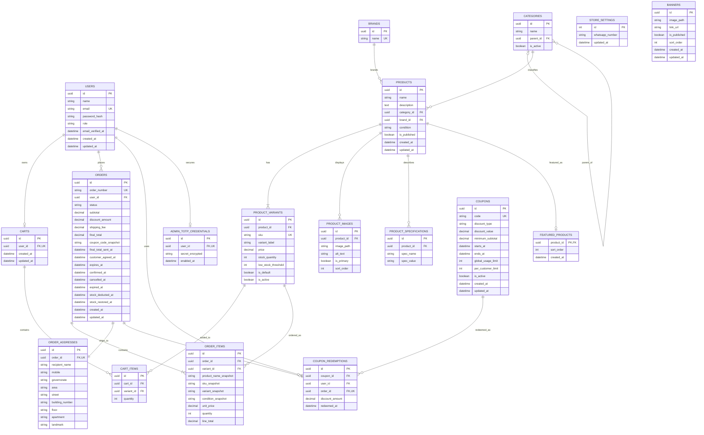

# Database Schema — E-commerce Website

**Version:** 1.1  
**Status:** Consolidated database design baseline — review before implementation  
**Database:** PostgreSQL  
**ORM:** TypeORM with JavaScript / CommonJS  
**Currency:** EGP

This document is the single source for the database design notes and Mermaid ER diagram. The diagram is embedded below so a separate `.mmd` file is not required.

> **Important:** This is a design baseline. Validate all constraints and migration behavior against the approved PRD/SRS before production use. Do not enable automatic schema synchronization in production.

## 1. Design principles

- Use UUID primary keys for application entities unless there is a documented reason not to.
- Use PostgreSQL `numeric(12,2)` for money. Never use floating-point types for monetary values.
- Store timestamps as `timestamptz` in the database and use UTC consistently.
- Use lowercase `snake_case` table and column names.
- Use database migrations for schema changes.
- Do not hard-delete products, variants, categories, brands, or users when historical records depend on them. Prefer deactivation/visibility flags.
- Recalculate prices, discounts, shipping, and totals on the server. Never trust totals supplied by the browser.
- Use transactions and concurrency-safe updates for order confirmation, inventory changes, and coupon usage.
- Product catalog metadata belongs to `products`; each purchasable SKU, its price, and stock belong to `product_variants`.
- A product with no customer-selectable options still has one default purchasable variant.

## 2. ER Diagram

The diagram is embedded in this file. In a Mermaid-compatible Markdown preview, it should render automatically. If the editor only displays source code, use the Mermaid Live Editor and paste the content between the `mermaid` fences.

## 3. Tables and fields

### 3.1 `users`

Stores customer and staff accounts.

| Column | Type | Rules |
|---|---|---|
| `id` | `uuid` | PK |
| `name` | `varchar(150)` | NOT NULL |
| `email` | `varchar(254)` | NOT NULL; unique after normalization |
| `password_hash` | `varchar(255)` | NOT NULL |
| `role` | `varchar(20)` | NOT NULL; CHECK in `customer`, `admin`, `super_admin` |
| `email_verified_at` | `timestamptz` | NULL until verified |
| `is_active` | `boolean` | NOT NULL DEFAULT `true` |
| `created_at` | `timestamptz` | NOT NULL DEFAULT `now()` |
| `updated_at` | `timestamptz` | NOT NULL DEFAULT `now()` |

Normalize email consistently (trim and lowercase) before storage and lookup. Enforce uniqueness on the normalized value. Backend authorization is required for every protected operation.

### 3.2 `admin_totp_credentials`

Stores TOTP credentials for admin accounts. Only admins and super admins should have a row.

| Column | Type | Rules |
|---|---|---|
| `id` | `uuid` | PK |
| `user_id` | `uuid` | NOT NULL, FK → `users.id`, UNIQUE |
| `secret_encrypted` | `text` | NOT NULL; encrypted at rest |
| `enabled_at` | `timestamptz` | NOT NULL |
| `created_at` | `timestamptz` | NOT NULL DEFAULT `now()` |

Never store TOTP secrets in plaintext or log them. Encryption key must live in environment/platform secret storage, not in the database.

### 3.3 `categories`

Supports top-level categories and nested subcategories.

| Column | Type | Rules |
|---|---|---|
| `id` | `uuid` | PK |
| `name` | `varchar(120)` | NOT NULL |
| `parent_id` | `uuid` | NULL, FK → `categories.id` |
| `slug` | `varchar(150)` | NOT NULL, UNIQUE |
| `is_active` | `boolean` | NOT NULL DEFAULT `true` |
| `sort_order` | `integer` | NOT NULL DEFAULT `0` |
| `created_at` | `timestamptz` | NOT NULL DEFAULT `now()` |
| `updated_at` | `timestamptz` | NOT NULL DEFAULT `now()` |

Prevent a category from being its own parent; application validation should also prevent cycles.

### 3.4 `brands`

| Column | Type | Rules |
|---|---|---|
| `id` | `uuid` | PK |
| `name` | `varchar(120)` | NOT NULL |
| `slug` | `varchar(150)` | NOT NULL, UNIQUE |
| `is_active` | `boolean` | NOT NULL DEFAULT `true` |
| `created_at` | `timestamptz` | NOT NULL DEFAULT `now()` |
| `updated_at` | `timestamptz` | NOT NULL DEFAULT `now()` |

### 3.5 `products`

Stores shared product/catalog information. Price and stock are not stored here; they belong to variants.

| Column | Type | Rules |
|---|---|---|
| `id` | `uuid` | PK |
| `name` | `varchar(200)` | NOT NULL |
| `slug` | `varchar(220)` | NOT NULL, UNIQUE |
| `description` | `text` | NULL |
| `category_id` | `uuid` | NOT NULL, FK → `categories.id` |
| `brand_id` | `uuid` | NULL, FK → `brands.id` |
| `condition` | `varchar(10)` | NOT NULL; CHECK `new` or `used` |
| `is_published` | `boolean` | NOT NULL DEFAULT `false` |
| `created_at` | `timestamptz` | NOT NULL DEFAULT `now()` |
| `updated_at` | `timestamptz` | NOT NULL DEFAULT `now()` |

Hiding/unpublishing a product must not delete its historical orders. A hidden product must not appear in public catalog/search/featured lists.

### 3.6 `product_variants`

Every purchasable unit is represented by a variant. A product with no selectable options uses a single default variant.

| Column | Type | Rules |
|---|---|---|
| `id` | `uuid` | PK |
| `product_id` | `uuid` | NOT NULL, FK → `products.id` |
| `sku` | `varchar(100)` | NOT NULL, UNIQUE |
| `variant_label` | `varchar(180)` | NOT NULL; e.g. `Default`, `16 GB / 1 TB` |
| `options` | `jsonb` | NULL; optional structured selectable options |
| `price` | `numeric(12,2)` | NOT NULL; CHECK `price >= 0` |
| `stock_quantity` | `integer` | NOT NULL DEFAULT `0`; CHECK `stock_quantity >= 0` |
| `low_stock_threshold` | `integer` | NOT NULL DEFAULT `0`; CHECK `low_stock_threshold >= 0` |
| `is_default` | `boolean` | NOT NULL DEFAULT `false` |
| `is_active` | `boolean` | NOT NULL DEFAULT `true` |
| `created_at` | `timestamptz` | NOT NULL DEFAULT `now()` |
| `updated_at` | `timestamptz` | NOT NULL DEFAULT `now()` |

Constraints:
- Enforce at most one default variant per product with a PostgreSQL partial unique index on `product_id WHERE is_default = true`.
- Ensure each product has exactly one default variant in the product creation/update service, using a transaction. A normal row-level CHECK cannot enforce this cross-row requirement by itself.
- Keep SKU unique even for inactive variants.
- Never let stock become negative. Confirmation must lock or atomically update stock rows and fail if any requested quantity is unavailable.

### 3.7 `product_images`

| Column | Type | Rules |
|---|---|---|
| `id` | `uuid` | PK |
| `product_id` | `uuid` | NOT NULL, FK → `products.id` |
| `image_path` | `text` | NOT NULL; relative path/key, not an arbitrary filesystem path from user input |
| `alt_text` | `varchar(250)` | NULL |
| `is_primary` | `boolean` | NOT NULL DEFAULT `false` |
| `sort_order` | `integer` | NOT NULL DEFAULT `0` |
| `created_at` | `timestamptz` | NOT NULL DEFAULT `now()` |

Use a partial unique index on `product_id WHERE is_primary = true` so a product cannot have two primary images. Validate image MIME type, size, and content at upload time. Persistent image storage on the selected host is a production release gate.

### 3.8 `product_specifications`

Stores flexible category-specific display specifications independently from purchasable variants.

| Column | Type | Rules |
|---|---|---|
| `id` | `uuid` | PK |
| `product_id` | `uuid` | NOT NULL, FK → `products.id` |
| `spec_name` | `varchar(120)` | NOT NULL |
| `spec_value` | `varchar(500)` | NOT NULL |
| `sort_order` | `integer` | NOT NULL DEFAULT `0` |

Unique constraint: (`product_id`, `spec_name`). If later requirements need centrally managed specification definitions, add a separate definitions table in a reviewed migration.

### 3.9 `carts`

One persistent cart per customer.

| Column | Type | Rules |
|---|---|---|
| `id` | `uuid` | PK |
| `user_id` | `uuid` | NOT NULL, FK → `users.id`, UNIQUE |
| `created_at` | `timestamptz` | NOT NULL DEFAULT `now()` |
| `updated_at` | `timestamptz` | NOT NULL DEFAULT `now()` |

### 3.10 `cart_items`

| Column | Type | Rules |
|---|---|---|
| `id` | `uuid` | PK |
| `cart_id` | `uuid` | NOT NULL, FK → `carts.id` |
| `variant_id` | `uuid` | NOT NULL, FK → `product_variants.id` |
| `quantity` | `integer` | NOT NULL; CHECK `quantity > 0` |
| `created_at` | `timestamptz` | NOT NULL DEFAULT `now()` |
| `updated_at` | `timestamptz` | NOT NULL DEFAULT `now()` |

Unique constraint: (`cart_id`, `variant_id`). If a product/variant becomes inactive or unpublished, checkout must reject it even if it remains in the cart. The cart itself may persist.

### 3.11 `orders`

Stores the order lifecycle and total snapshots. At checkout, the order is `pending`; stock is not deducted yet.

| Column | Type | Rules |
|---|---|---|
| `id` | `uuid` | PK |
| `order_number` | `varchar(40)` | NOT NULL, UNIQUE, generated server-side |
| `user_id` | `uuid` | NOT NULL, FK → `users.id` |
| `status` | `varchar(20)` | NOT NULL; CHECK allowed statuses below |
| `subtotal` | `numeric(12,2)` | NOT NULL; product subtotal before discount/shipping |
| `discount_amount` | `numeric(12,2)` | NOT NULL DEFAULT `0` |
| `shipping_fee` | `numeric(12,2)` | NULL until admin sets it |
| `final_total` | `numeric(12,2)` | NULL until final total is calculated and sent |
| `coupon_code_snapshot` | `varchar(80)` | NULL |
| `final_total_sent_at` | `timestamptz` | NULL until admin records sending the final total |
| `customer_agreed_at` | `timestamptz` | NULL until customer agrees |
| `expires_at` | `timestamptz` | NULL until final total is sent; then set to 24 hours later |
| `confirmed_at` | `timestamptz` | NULL until confirmation |
| `cancelled_at` | `timestamptz` | NULL unless cancelled |
| `expired_at` | `timestamptz` | NULL unless expired |
| `stock_deducted_at` | `timestamptz` | NULL until stock deduction commits |
| `stock_restored_at` | `timestamptz` | NULL unless deducted stock is restored |
| `created_at` | `timestamptz` | NOT NULL DEFAULT `now()` |
| `updated_at` | `timestamptz` | NOT NULL DEFAULT `now()` |

Allowed statuses: `pending`, `confirmed`, `processing`, `delivered`, `cancelled`, `expired`.

Total checks should ensure `subtotal >= 0`, `discount_amount >= 0`, and any present `shipping_fee` and `final_total` are non-negative. The server calculates the final total as `subtotal - discount_amount + shipping_fee`; validate discount does not exceed the eligible subtotal.

Lifecycle rules:
- Pending → Confirmed, Cancelled, Expired.
- Confirmed → Processing or Cancelled.
- Processing → Delivered, or Cancelled only after admin review/approval.
- Delivered, Cancelled, and Expired are terminal.
- Only Pending can be directly cancelled by the customer; later cancellation requests go through WhatsApp and admin review.
- The 24-hour expiration deadline begins when the admin records that the final total, including shipping, was sent. Pending orders with no `final_total_sent_at` do not expire automatically under this rule and must be highlighted in the admin dashboard.
- Stock deduction, coupon redemption, order status change, and the relevant timestamps must be coordinated in one transaction at confirmation.
- Stock restoration after cancellation must happen at most once, in a transaction, if stock had previously been deducted.
- Enforce status transitions in the application service; a database CHECK only validates the set of status values, not transition history.

### 3.12 `order_items`

Immutable purchase snapshots for historical display.

| Column | Type | Rules |
|---|---|---|
| `id` | `uuid` | PK |
| `order_id` | `uuid` | NOT NULL, FK → `orders.id` |
| `variant_id` | `uuid` | NULL, FK → `product_variants.id` with `ON DELETE SET NULL` if hard deletion is ever allowed |
| `product_name_snapshot` | `varchar(200)` | NOT NULL |
| `sku_snapshot` | `varchar(100)` | NOT NULL |
| `variant_snapshot` | `varchar(180)` | NOT NULL |
| `condition_snapshot` | `varchar(10)` | NOT NULL |
| `unit_price` | `numeric(12,2)` | NOT NULL; CHECK `unit_price >= 0` |
| `quantity` | `integer` | NOT NULL; CHECK `quantity > 0` |
| `line_total` | `numeric(12,2)` | NOT NULL; unit price × quantity after server calculation |

Prefer deactivating catalog records instead of hard deletion. Snapshots preserve names, SKU, condition, and prices if catalog data changes later.

### 3.13 `order_addresses`

A single shipping-address snapshot for each order.

| Column | Type | Rules |
|---|---|---|
| `id` | `uuid` | PK |
| `order_id` | `uuid` | NOT NULL, FK → `orders.id`, UNIQUE |
| `recipient_name` | `varchar(150)` | NOT NULL |
| `mobile` | `varchar(30)` | NOT NULL |
| `governorate` | `varchar(100)` | NOT NULL |
| `area` | `varchar(150)` | NOT NULL |
| `street` | `varchar(200)` | NOT NULL |
| `building_number` | `varchar(50)` | NOT NULL |
| `floor` | `varchar(30)` | NULL |
| `apartment` | `varchar(30)` | NULL |
| `landmark` | `varchar(250)` | NULL |

Do not reference a mutable customer address record for the historical order snapshot.

### 3.14 `coupons`

| Column | Type | Rules |
|---|---|---|
| `id` | `uuid` | PK |
| `code` | `varchar(80)` | NOT NULL, unique after normalization |
| `discount_type` | `varchar(12)` | NOT NULL; CHECK `percentage` or `fixed` |
| `discount_value` | `numeric(12,2)` | NOT NULL; CHECK `discount_value > 0`; percentage must be ≤ 100 |
| `minimum_subtotal` | `numeric(12,2)` | NULL or non-negative |
| `starts_at` | `timestamptz` | NULL means valid immediately when enabled |
| `ends_at` | `timestamptz` | NOT NULL |
| `global_usage_limit` | `integer` | NULL means unlimited; otherwise > 0 |
| `per_customer_limit` | `integer` | NULL means unlimited; otherwise > 0 |
| `is_active` | `boolean` | NOT NULL DEFAULT `true` |
| `created_at` | `timestamptz` | NOT NULL DEFAULT `now()` |
| `updated_at` | `timestamptz` | NOT NULL DEFAULT `now()` |

Require `ends_at > starts_at` when `starts_at` is not null. A fixed discount is capped at the eligible product subtotal; the order total must never be negative. Coupons apply before shipping and cannot be stacked.

### 3.15 `coupon_redemptions`

Only successful order confirmations count toward coupon usage.

| Column | Type | Rules |
|---|---|---|
| `id` | `uuid` | PK |
| `coupon_id` | `uuid` | NOT NULL, FK → `coupons.id` |
| `user_id` | `uuid` | NOT NULL, FK → `users.id` |
| `order_id` | `uuid` | NOT NULL, FK → `orders.id`, UNIQUE |
| `discount_amount` | `numeric(12,2)` | NOT NULL; CHECK `discount_amount >= 0` |
| `redeemed_at` | `timestamptz` | NOT NULL DEFAULT `now()` |

At confirmation, revalidate coupon dates, active state, subtotal, and limits. Lock the coupon row or use another concurrency-safe method so simultaneous confirmations cannot exceed limits. Pending, cancelled, and expired orders do not count as redemptions.

### 3.16 `store_settings`

Stores the store-wide WhatsApp number editable by Super Admin without redeploying.

| Column | Type | Rules |
|---|---|---|
| `id` | `smallint` | PK; enforce singleton value `1` with CHECK |
| `whatsapp_number` | `varchar(30)` | NOT NULL |
| `updated_at` | `timestamptz` | NOT NULL DEFAULT `now()` |

Seed exactly one row with `id = 1`. Protect updates with backend Super Admin authorization.

### 3.17 `banners`

| Column | Type | Rules |
|---|---|---|
| `id` | `uuid` | PK |
| `image_path` | `text` | NOT NULL |
| `link_url` | `text` | NULL |
| `is_published` | `boolean` | NOT NULL DEFAULT `false` |
| `sort_order` | `integer` | NOT NULL DEFAULT `0` |
| `created_at` | `timestamptz` | NOT NULL DEFAULT `now()` |
| `updated_at` | `timestamptz` | NOT NULL DEFAULT `now()` |

Validate link schemes and image uploads. Do not store user-provided arbitrary server filesystem paths.

### 3.18 `featured_products`

Manual selection and ordering of featured products.

| Column | Type | Rules |
|---|---|---|
| `product_id` | `uuid` | PK, FK → `products.id` |
| `sort_order` | `integer` | NOT NULL DEFAULT `0` |
| `created_at` | `timestamptz` | NOT NULL DEFAULT `now()` |

Only published products should be returned by the public featured-products query. The database row may remain when a product is unpublished.

### 3.19 `email_verification_challenges`

Stores email verification challenges without storing the OTP in plaintext.

| Column | Type | Rules |
|---|---|---|
| `id` | `uuid` | PK |
| `user_id` | `uuid` | NOT NULL, FK → `users.id` |
| `token_hash` | `varchar(255)` | NOT NULL |
| `expires_at` | `timestamptz` | NOT NULL |
| `consumed_at` | `timestamptz` | NULL |
| `attempt_count` | `integer` | NOT NULL DEFAULT `0`; CHECK `attempt_count >= 0` |
| `created_at` | `timestamptz` | NOT NULL DEFAULT `now()` |

Verification codes expire after 10 minutes and are single-use. Rate limiting must also be enforced at the API/service layer. Never log the raw OTP. Expired/consumed rows can be cleaned up safely by a scheduled task.

### 3.20 `sessions`

Database-backed session records allow server-side invalidation and inactivity enforcement.

| Column | Type | Rules |
|---|---|---|
| `id` | `uuid` | PK |
| `user_id` | `uuid` | NOT NULL, FK → `users.id` |
| `session_token_hash` | `varchar(255)` | NOT NULL, UNIQUE |
| `last_activity_at` | `timestamptz` | NOT NULL |
| `expires_at` | `timestamptz` | NOT NULL |
| `revoked_at` | `timestamptz` | NULL |
| `created_at` | `timestamptz` | NOT NULL DEFAULT `now()` |

Store only a hash of the opaque session token if implementing a custom session table. If using a standard Express session store, align this table with the selected store rather than maintaining two competing session mechanisms. Enforce the approved inactivity limits server-side: 30 days for customers and 60 minutes for admins. Logout revokes the session.

### 3.21 `inventory_adjustments`

Records the reason and responsible admin for manual stock changes.

| Column | Type | Rules |
|---|---|---|
| `id` | `uuid` | PK |
| `variant_id` | `uuid` | NOT NULL, FK → `product_variants.id` |
| `admin_user_id` | `uuid` | NOT NULL, FK → `users.id` |
| `quantity_delta` | `integer` | NOT NULL; CHECK `quantity_delta <> 0` |
| `reason` | `varchar(300)` | NOT NULL |
| `created_at` | `timestamptz` | NOT NULL DEFAULT `now()` |

The stock update and adjustment record must be written in the same transaction. This table covers manual inventory adjustments; it is not intended as a comprehensive audit log of every application event.

## 4. Indexes and uniqueness summary

Create indexes through migrations. In addition to PK/unique indexes, consider:

- `users`: unique normalized email; index on `role` only if query patterns justify it.
- `categories`: index on `parent_id`; unique `slug`.
- `products`: index on `(is_published, category_id)`; index on `brand_id`; index on `created_at`; unique `slug`.
- `product_variants`: unique `sku`; index on `product_id`; partial unique index on `product_id WHERE is_default = true`; optional index for active/stock queries based on actual query patterns.
- `product_images`: index on `product_id`; partial unique index on `product_id WHERE is_primary = true`.
- `product_specifications`: unique `(product_id, spec_name)`.
- `carts`: unique `user_id`.
- `cart_items`: unique `(cart_id, variant_id)`; index on `variant_id`.
- `orders`: unique `order_number`; index on `(user_id, created_at DESC)`; index on `(status, expires_at)` for admin queues/expiration worker.
- `order_items`: index on `order_id`; index on `variant_id`.
- `order_addresses`: unique `order_id`.
- `coupons`: unique normalized `code`; index on `(is_active, ends_at)`.
- `coupon_redemptions`: unique `order_id`; index on `(coupon_id, redeemed_at)`; index on `(user_id, coupon_id)`.
- `email_verification_challenges`: index on `(user_id, created_at DESC)` and `expires_at`.
- `sessions`: unique token hash; index on `(user_id, revoked_at)` and `expires_at`.
- `inventory_adjustments`: index on `(variant_id, created_at DESC)`.

Do not add indexes indiscriminately; confirm them against real query patterns and query plans.

## 5. Foreign-key deletion behavior

Recommended defaults:
- `products.category_id` and `products.brand_id`: `RESTRICT` deletion while referenced; deactivate categories/brands instead.
- `product_variants.product_id`: `RESTRICT`; do not remove variants used by orders.
- `product_images.product_id`, `product_specifications.product_id`: `CASCADE` only if the product itself is legitimately hard-deleted; normal operation should unpublish/deactivate products.
- `cart_items.cart_id`: `CASCADE` when a cart is deleted.
- `cart_items.variant_id`: `RESTRICT` or deactivate the variant rather than deleting it.
- `orders.user_id`: `RESTRICT`; preserve order ownership/history.
- `order_items.order_id`, `order_addresses.order_id`: `CASCADE` only as part of an explicitly approved order purge policy; normal application operations should not hard-delete orders.
- `order_items.variant_id`: `SET NULL` if hard deletion is ever allowed, since snapshots preserve historical details.
- `coupon_redemptions` should not be removed to reset usage counts; preserve records used for limits and order consistency.
- `sessions`, `email_verification_challenges`: may be deleted when the user is hard-deleted under a reviewed retention policy; normal account deactivation is preferred.

Review every `ON DELETE` choice in the TypeORM migrations; do not rely on ORM defaults.

## 6. Application invariants not enforced by simple column types

The application and transactions must enforce:

1. Every product has exactly one default variant.
2. Only active/published products and active variants can be checked out.
3. Stock is not deducted when a Pending order is created.
4. Order confirmation revalidates current price, coupon limits, and stock in a transaction.
5. Concurrent confirmations cannot oversell inventory or exceed coupon limits.
6. Stock deduction and restoration occur at most once per order.
7. Coupon redemption is created only when confirmation succeeds.
8. The order expires 24 hours after `final_total_sent_at`, not 24 hours after order creation.
9. Order status transitions follow the approved lifecycle.
10. Only Super Admin can create/update/deactivate admin accounts and change store-wide WhatsApp settings.
11. Admin TOTP is required for admin access.
12. Customers can read only their own cart, profile, and orders.
13. A hidden product is omitted from public catalog/search/featured results but historical order snapshots remain readable.
14. Order item snapshots and order address snapshots are not silently rewritten when catalog/customer data changes.
15. Email verification challenges are hashed, expire after 10 minutes, and can be consumed only once.

## 7. Implementation checklist

Before creating production migrations:

- [ ] Compare every table and invariant with the approved PRD/SRS.
- [ ] Decide whether the chosen session library needs a custom `sessions` table or its own store.
- [ ] Implement normalized unique indexes for email and coupon code.
- [ ] Implement partial unique indexes for default variants and primary images.
- [ ] Add CHECK constraints for non-negative prices/stock/totals, positive quantities, valid roles/statuses, coupon types, and percentage bounds.
- [ ] Confirm FK deletion behavior explicitly.
- [ ] Seed the singleton `store_settings` row.
- [ ] Write migrations and tests for order confirmation, coupon concurrency, stock restoration, and expiration.
- [ ] Test backup and restore before production launch.
- [ ] Verify the selected host supports persistent image storage; ephemeral storage is not acceptable for production product images.
- [ ] Verify current free-tier limits and terms for hosting, PostgreSQL, email verification, and background jobs before selecting providers.

## 8. Mermaid troubleshooting

If the diagram does not render:
1. Make sure the preview supports Mermaid.
2. Copy only the content inside the `mermaid` fenced block into <https://mermaid.live/>.
3. If the editor reports a syntax error, use the error location to correct the diagram and keep this document as the single source.
