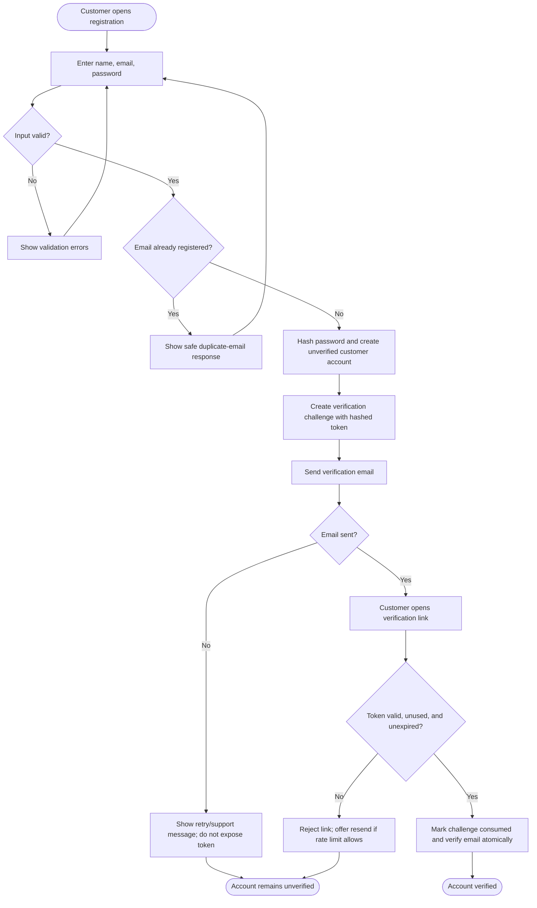
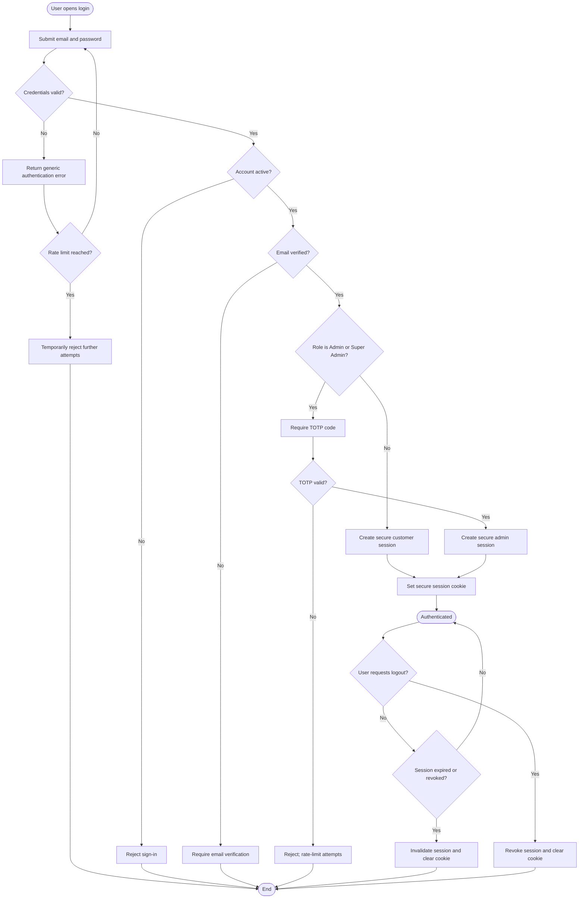
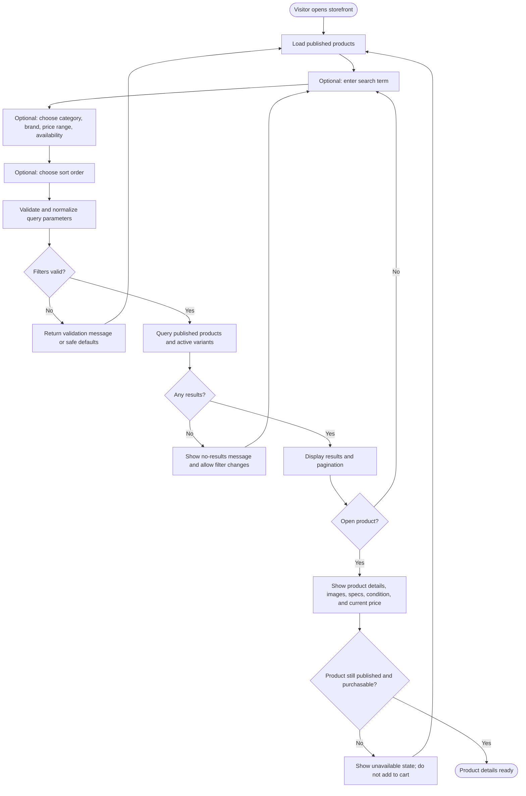
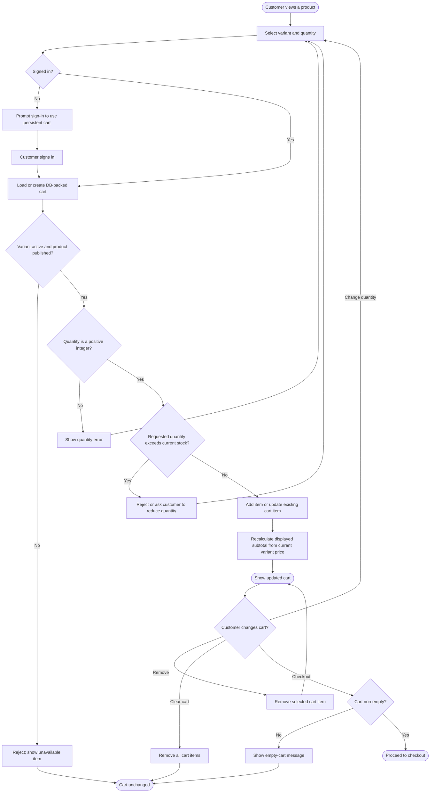
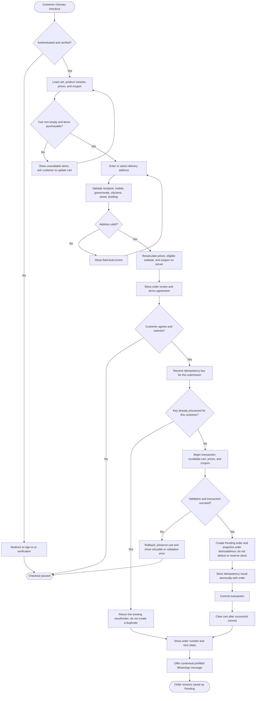
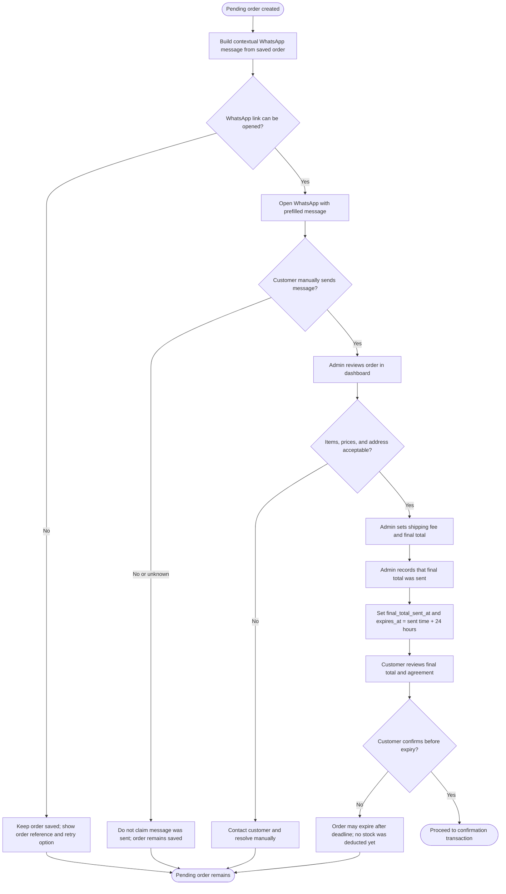
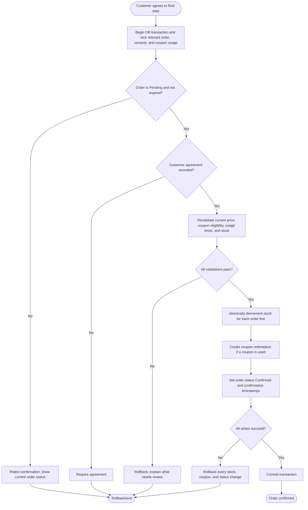
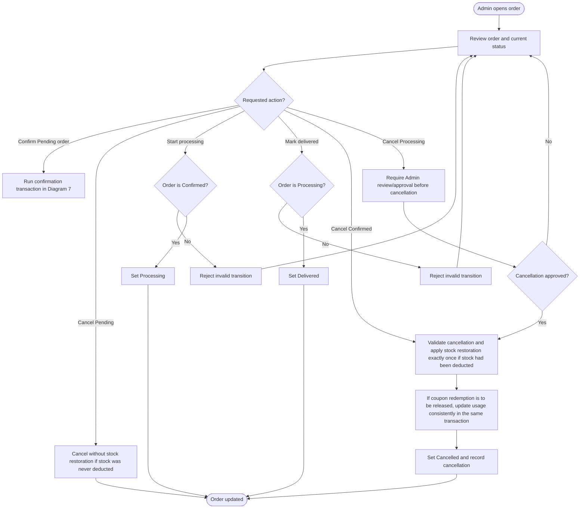
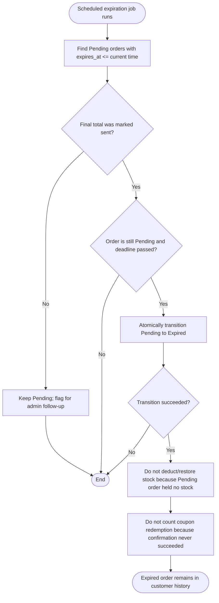
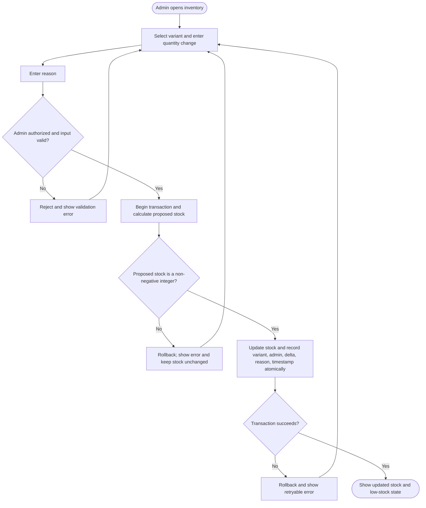

# E-commerce Website — Workflow Diagrams

**Version:** 1.1  
**Status:** Reviewed against SRS v1.0  
**Basis:** Approved MVP decisions and SRS v1.0  
**Notation:** Mermaid flowcharts. Diamonds represent decisions; error paths are shown explicitly.

> These diagrams document the agreed MVP behavior. They do not introduce new features. Any unresolved behavior is marked as an assumption or review point rather than silently changing the requirements.

## 1. Registration and Email Verification

**Required safeguards**
- Rate-limit registration, verification attempts, and resend requests.
- Verification token is single-use, expires after 10 minutes, and is stored hashed.
- Never log passwords, tokens, or OTPs.
- A failed email delivery must not mark the account verified.

## 2. Login, Session, and Logout

**Session policy**
- Customer inactivity timeout: 30 days.
- Admin/Super Admin inactivity timeout: 60 minutes.
- Enforce expiry and revocation on the backend; use secure cookie settings and appropriate CSRF protection.
- Super Admin provisions administrator accounts; there is no public admin registration.

## 3. Product Browsing and Search

**Catalog rules**
- Unpublished products are not visible to public customers.
- Zero-stock products may remain visible; the UI must not imply they can currently be purchased.
- Do not expose exact inventory counts or internal low-stock thresholds to public users.
- Variant price and stock are authoritative for purchase operations.

## 4. Persistent Cart

**Cart rules**
- Cart persists across logout and devices because it is stored in the database.
- Checkout requires authentication.
- Cart contents are not a stock reservation. Recheck stock and prices at checkout and confirmation.
- A cart item becoming unavailable must be surfaced clearly; do not silently fulfill it.

## 5. Checkout and Order Creation

**Important**
- The server, not the browser, calculates prices, discounts, and totals.
- Initial order creation does **not** reserve or deduct inventory.
- Check the idempotency key before creating an order; enforce uniqueness and persist the key/result atomically with the order.
- Revalidate server-side data within the order-creation transaction.
- Clear the cart only after the order transaction commits successfully. If it fails, preserve the cart.
- Save the order before opening WhatsApp. WhatsApp launch or send failure must not erase the order.

## 6. WhatsApp Handoff and Admin Final Total

**Rules**
- WhatsApp is a manual handoff, not an API-based delivery confirmation.
- If WhatsApp is not opened or the customer does not send the message, keep the saved order and provide its reference.
- The 24-hour expiry clock starts only when the admin marks the final total as sent.
- Pending orders without a recorded sent-final-total timestamp do not expire automatically; highlight them to admins.

## 7. Order Confirmation, Stock, and Coupon Atomicity

**Consistency requirements**
- Lock or atomically condition-update stock so concurrent orders cannot oversell.
- Coupon limits must be checked and consumed in the same transaction as confirmation.
- Failed confirmation must not leave partial stock deductions or coupon redemptions.
- Confirmation retries must not deduct stock or redeem a coupon twice.
- Customer must see a clear outcome if the final price, stock, coupon validity, or order state changed.

## 8. Admin Order Status and Cancellation

**Allowed status transitions**
- `Pending → Confirmed`, `Cancelled`, or `Expired`
- `Confirmed → Processing` or `Cancelled`
- `Processing → Delivered` or `Cancelled` only after admin review/approval
- `Delivered`, `Cancelled`, and `Expired` are terminal states.

**Cancellation safeguards**
- Customer can directly cancel only a Pending order; later cancellation requests go through WhatsApp/Admin.
- Restore deducted stock exactly once, guarded by transaction/state checks.
- Do not allow invalid status jumps.
- **Policy point requiring confirmation:** the SRS says coupon usage is counted on confirmation and pending/expired/cancelled orders do not count. For a previously confirmed order that is later cancelled, the implementation should release/reverse that redemption so it no longer counts, unless the owner explicitly decides otherwise.

## 9. Pending Order Expiration

## 10. Inventory Adjustment by Admin

## 11. Review Checklist Before Approval

- [ ] Registration covers invalid input, duplicate email, email-send failure, expired/used token, and rate limits.
- [ ] Login covers invalid credentials, inactive/unverified accounts, admin TOTP, and session expiry.
- [ ] Cart rechecks variant status and stock and does not reserve stock.
- [ ] Checkout persists the order before WhatsApp handoff and handles retry/idempotency.
- [ ] Admin final-total timestamp is the start of the 24-hour expiry window.
- [ ] Confirmation is transactional across order status, inventory, and coupon redemption.
- [ ] Cancellation restores stock exactly once and follows allowed status transitions.
- [ ] Expiration only affects eligible Pending orders.
- [ ] WhatsApp is never represented as automatically sent.
- [ ] Remaining policy questions are explicitly decided before implementation.

## 12. Open Review Points

1. **Cart clearing — resolved:** clear only after successful order-creation commit; preserve the cart on failure.
2. **Confirmed-order cancellation and coupon usage — resolved from SRS:** cancelled orders do not count toward coupon limits. If a confirmed order is cancelled, release its redemption/usage in the same transaction as cancellation, exactly once.
3. **Price changes before confirmation — resolved from SRS:** confirmation is blocked until discrepancies are resolved and the customer approves a revised total when required. Update the current order snapshot; the MVP does not retain a detailed edit history. Record agreement against the current version/total.
4. **Email verification retry — implementation rule:** resend only within rate limits and invalidate prior unconsumed challenges when issuing a replacement; challenges remain hashed, single-use, and time-limited.
5. **Inventory adjustment validation — resolved:** validate proposed stock before applying changes; stock must remain a non-negative integer. Update stock and write the reasoned adjustment record atomically.
6. **Idempotency ordering — corrected:** check the customer-scoped idempotency key before creating the order and persist the key/result atomically with the order.

No unresolved policy blocker remains in these workflow diagrams. Technical implementation details (database lock strategy, scheduled-job mechanism, and email provider) remain design choices and must satisfy the requirements above.
